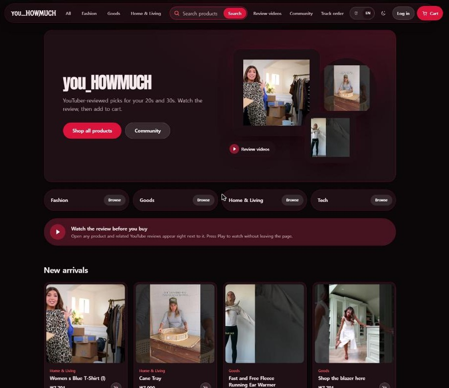
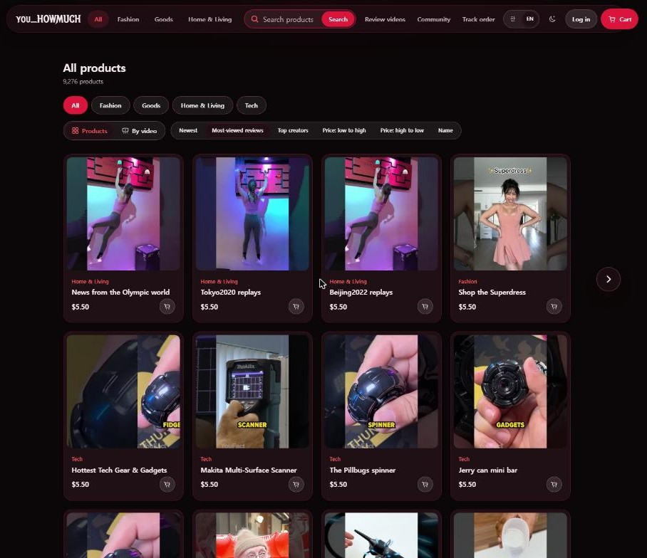
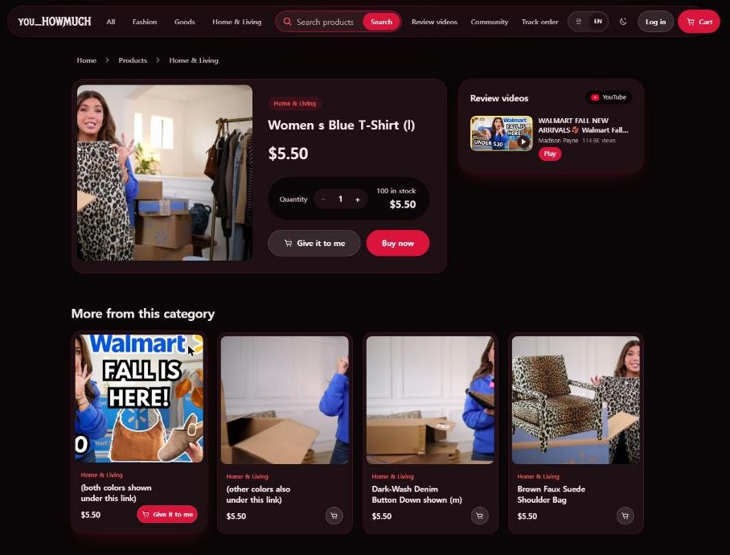
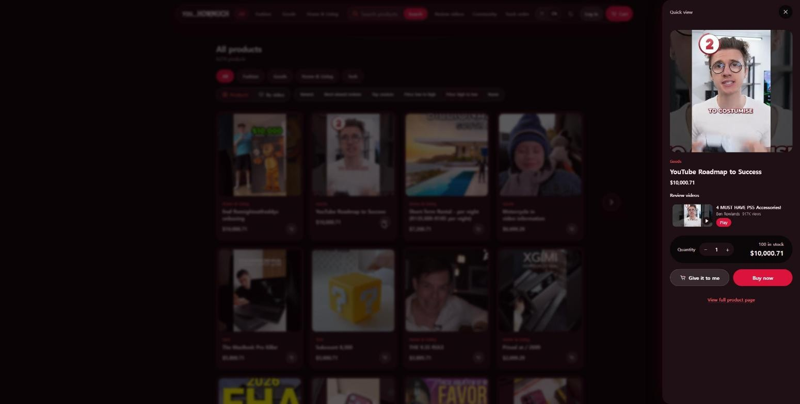
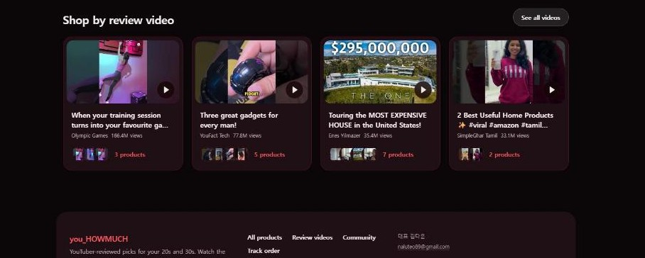
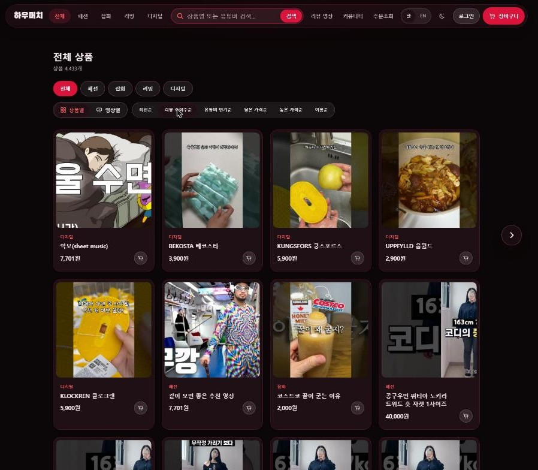
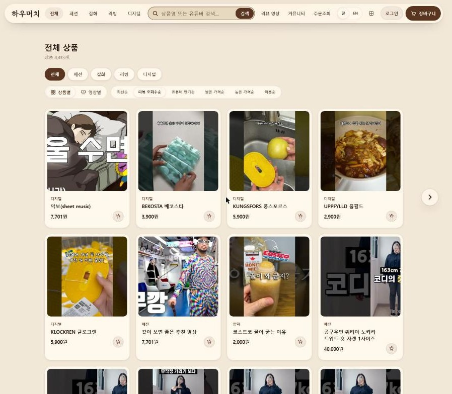

# you_HOWMUCH

[한국어](README.md) · **English**

> YouTuber-reviewed picks for your 20s and 30s — **watch the review, then add to cart.**

you_HOWMUCH is a shop built around YouTube review videos. It automatically collects the products mentioned in review videos and shows each product next to its review, so you can watch and buy on the same screen.
Visit in Korean and you get Korean YouTubers and Korean products; visit in English and you get YouTubers and products from the US/UK market, priced in dollars.

A non-commercial personal portfolio project — planning, data collection, backend, frontend and design by one person.



| Products · USD prices | Product page + review video panel |
|---|---|
|  |  |

| Quick view ("Give it to me") | Shop by review video |
|---|---|
|  |  |

| Korean site — dark gothic | Korean site — white chocolate |
|---|---|
|  |  |

---

## Why the English site works this way

The English site is **not a translation of the Korean site. It is a separate storefront for English-speaking shoppers.**

| Decision | What it does | Why |
|---|---|---|
| A market switch, not a translation | In English, only products collected from US/English-language YouTube reviews (`regionCode=US`) are shown, with English names (Korea 4,433 / US 9,276 products, no overlap) | Translating the labels alone would show English speakers Korean YouTubers and Korean products, which is useless to them |
| Detected on the first visit | Saved choice (cookie) → browser language → visitor country → Korean | First-time visitors land in their own market; once someone picks a language, that choice wins |
| Prices in dollars | Storage, orders and stock stay in a single currency (KRW); only the English display is converted to USD (1 USD = 1,400 KRW, the same rate the collector used) | English speakers have no feel for won. Keeping one calculation path avoids order and payment bugs, and converting back with the collector's rate returns roughly the original dollar price |
| Two brand names | Korean "하우머치" (how-meo-chi) / English "you_HOWMUCH" | Korean visitors get a friendly phonetic name; English visitors read "How much?" straight away |
| Type | The expressive display font appears only on the English logo and page titles. Korean pages, product names and descriptions use a plain sans-serif | Decorative Korean fonts hurt readability, and product information must be easy to read in any language |
| Tone of voice | English "Give it to me" / Korean "장바구니에 담기" (add to cart) | English uses a casual tone for a 20s–30s audience; Korean shoppers read the familiar term faster |
| One place for copy | All UI text lives in `lib/i18n/dictionaries.ts`; the type system forces the English dictionary to have every Korean key | A string updated in one language but forgotten in the other fails the build |

> Known limitation: prices are stored in KRW rounded up to the nearest 1,000 won, so some dollar prices end in odd cents (e.g. $10,000.71). Storing the original dollar price from the review is planned.

---

## Core features

The full list, with status and code locations, lives in **[docs/FEATURES.md](docs/FEATURES.md)** (Korean). Update that one file when a feature changes.

| Feature | Summary |
|---|---|
| Video ↔ product | Review-video panel next to each product; the YouTube player loads only when you press Play |
| View modes | Switch between products and "by video" (products grouped under the video they appeared in) |
| Quick view | Cart icon next to the price opens an option sheet; clicking the card opens the product page |
| Language = market | Korean → Korean products, YouTubers and won / English → US products, YouTubers and dollars |
| Auto collection | Products are read from YouTube video descriptions (2,488 videos → 13,709 products) |
| Fast lists | 40 items per page from the server (one page went from 10.7 MB to 116 KB); ‹ › buttons and ← → keys |
| Accounts | Email sign-up and login, a unique auto-generated nickname you can change, 14-day "keep me signed in" |
| Themes | Dark gothic (black + crimson) by default, white chocolate (cream + brown) light mode |

---

## How to use the site

1. **Browse** — pick a category (Fashion · Goods · Home & Living · Tech) or search by product or YouTuber name.
2. **Change the view** — use `Products / By video` above the list. "By video" groups products from the same review.
3. **Sort** — newest, most-viewed reviews, top creators, price low/high, name.
4. **Turn pages** — the `‹ ›` buttons beside the list, the page numbers below it, or the `←` `→` keys.
5. **Add quickly** — press the cart icon next to a price to open Quick view, choose options and quantity, then `Give it to me`. Clicking the card itself opens the product page.
6. **Watch the review** — on a product page, press `Play` in the review panel to watch without leaving the page.
7. **Order** — cart → checkout → mock payment. Guest checkout works; track an order with the order number and phone number.
8. **Sign up** — enter email and password; a suggested nickname is filled in. Re-roll it 🔄 or type your own, and change it later in your account.
9. **Language and theme** — `한 / EN` switches language (and market and currency); 🌙 switches dark/light. Both are remembered.

---

## Running it locally

```
I_sell_a_store/
├── backend/    Spring Boot 3.5.6 · Java 21 · JPA + JdbcTemplate · MySQL 8
├── frontend/   Next.js 15 (App Router) · CSS Modules + design tokens · Zustand
└── docs/       FEATURES.md (feature list) · images/ (README screenshots)
```

**Requirements:** JDK 21 and Maven, Node.js 20+, MySQL 8.0 (database `my_db`), and a YouTube Data API v3 key (optional; without it, video search and collection are disabled).

1. **Database** — run `backend/db/schema.sql` once. For an existing database, run the add-on scripts once each: `auth.sql`, `sourcing.sql`, `market.sql`, `frame-images.sql`. Local DB credentials are in `backend/config/application.yml` (local only; change them before any public deployment).
2. **Backend** — http://localhost:8080
   ```powershell
   cd backend
   $env:YOUTUBE_API_KEY="your_key"   # never commit the key
   mvn spring-boot:run
   ```
   Health check: http://localhost:8080/api/health/db. Restart the backend after changing `application.yml`.
3. **Frontend** — http://localhost:3000
   ```powershell
   cd frontend
   copy .env.example .env.local
   npm install
   npm run dev
   ```
   `NEXT_PUBLIC_USD_KRW_RATE` (default 1400) sets the dollar conversion; keep it equal to the backend's `sourcing.usd-krw-rate`.
4. **Collect demo products (optional)**
   ```powershell
   curl.exe -X POST "http://localhost:8080/api/admin/sourcing/start"   # Korea and US, alternating
   curl.exe "http://localhost:8080/api/admin/sourcing/status"
   curl.exe -X POST "http://localhost:8080/api/admin/sourcing/stop"
   ```
   One search page costs 100 quota units; the default daily quota is 10,000 units.

**Admin:** http://localhost:3000/admin opens only when `NEXT_PUBLIC_ENABLE_ADMIN=true`. ⚠️ The admin API has no authentication yet; lock it down before deploying publicly.

---

## Notes
- Videos play only in YouTube's official embedded player. Following the [YouTube API Developer Policies](https://developers.google.com/youtube/terms/developer-policies), the site does not block ads or modify the player.
- Product images are frames from the review videos. An image-source policy is needed before running this as a public service.

## Contact
김다운 · [naluteo89@gmail.com](mailto:naluteo89@gmail.com)
