# you_HOWMUCH (하우머치)

**한국어** · [English](README.en.md)

> 요즘 20·30을 위한 유튜버 리뷰템 — **영상으로 보고, 바로 담는** 쇼핑몰

유튜브 리뷰 영상에 나온 상품을 자동으로 모아, 영상과 상품을 한 화면에서 보고 바로 장바구니에 담을 수 있게 만든 쇼핑몰입니다.
한국어로 접속하면 한국 유튜버·한국 상품이, 영어로 접속하면 영미권 유튜버·영미권 상품이 나옵니다.

비상업 개인 포트폴리오 프로젝트입니다. (기획 · 데이터 수집 · 백엔드 · 프론트엔드 · 디자인 1인 제작)

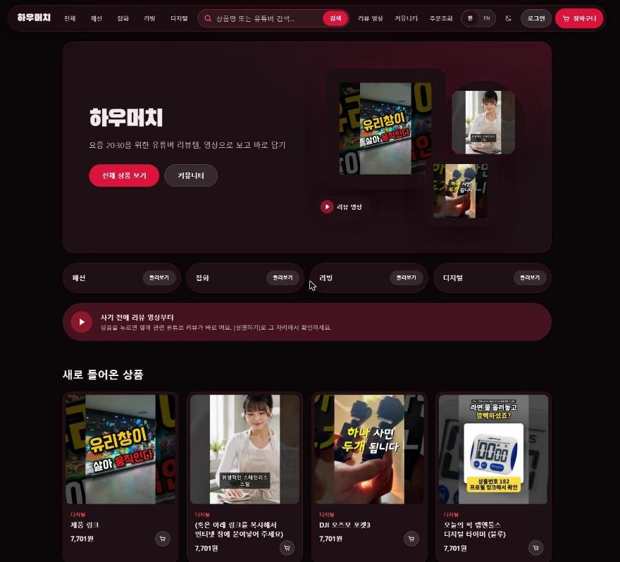

| 상품 목록 (다크) | 상품 목록 (화이트 초콜릿) |
|---|---|
| 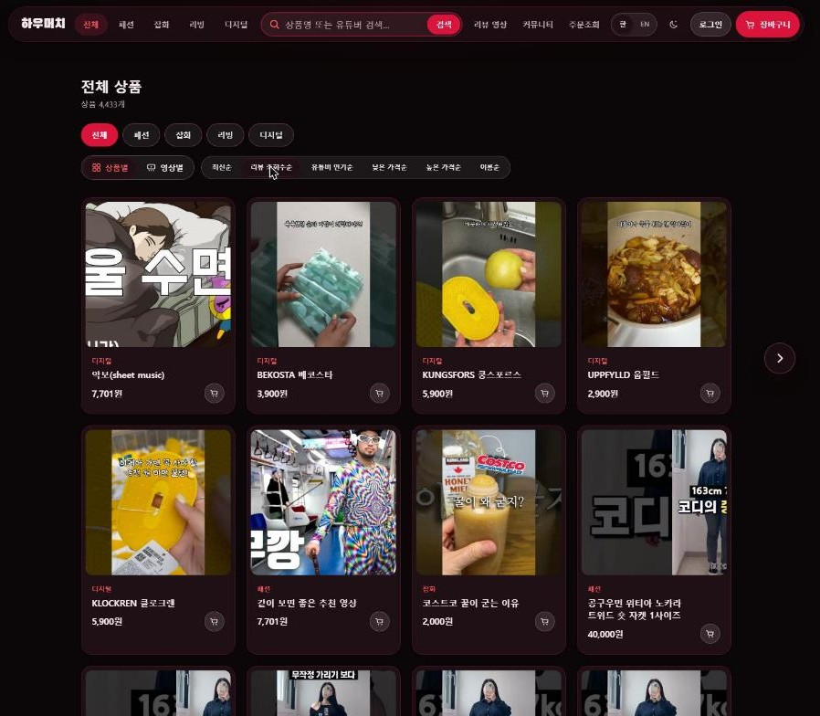 | 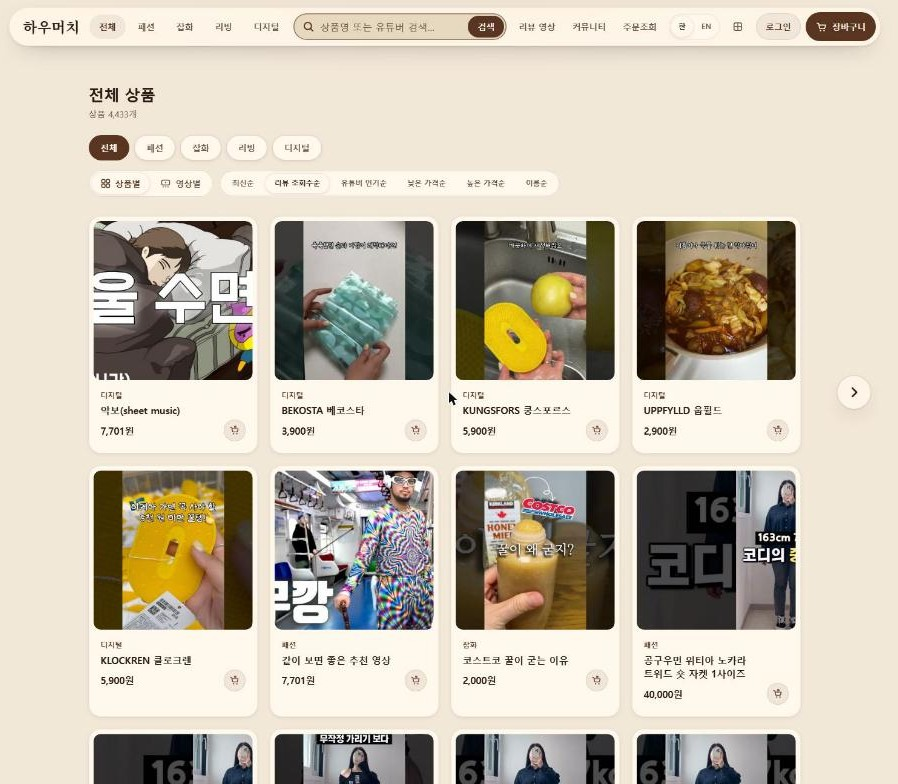 |

| 영상별 묶음 보기 | 상품 상세 + 리뷰 영상 패널 |
|---|---|
| 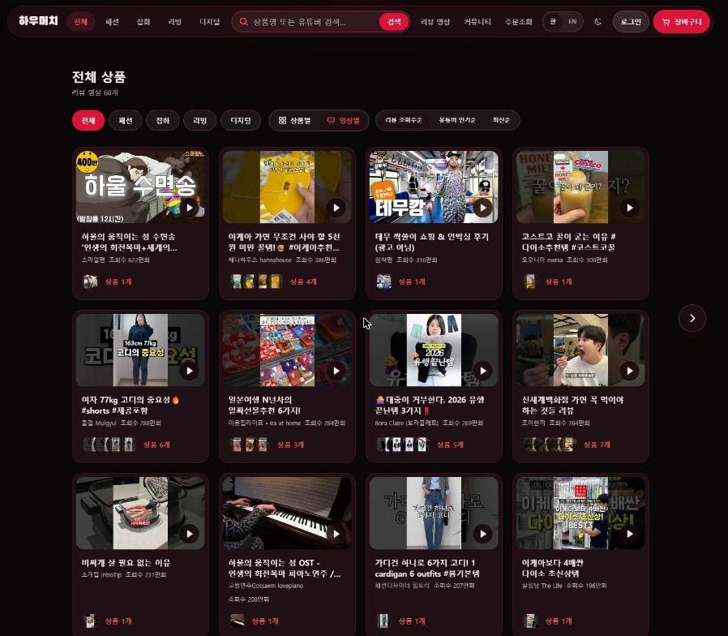 | 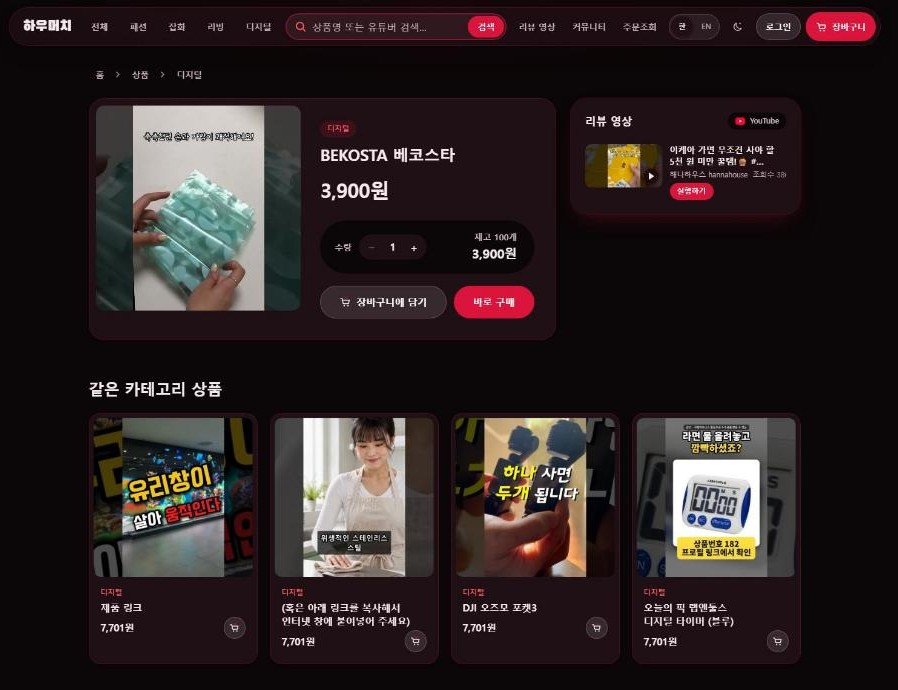 |

| 빠른 보기 (장바구니에 담기) | 회원가입 · 자동 닉네임 |
|---|---|
| 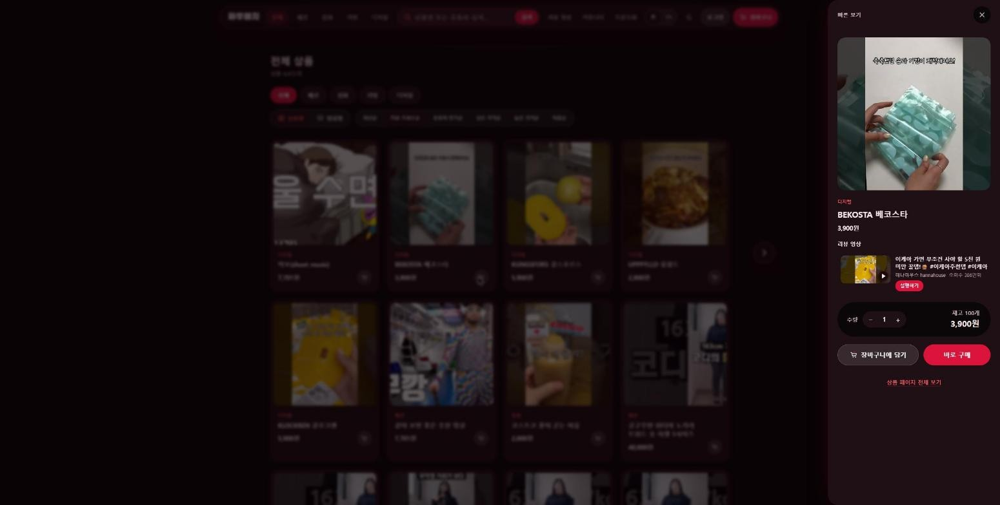 | 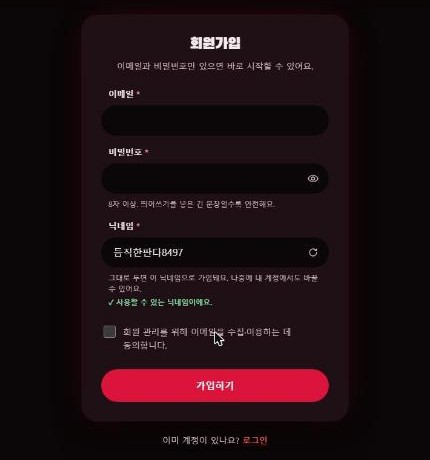 |

### 영문 페이지 (you_HOWMUCH)

| 영문 메인 | 영미권 상품 · 달러 표시 |
|---|---|
| 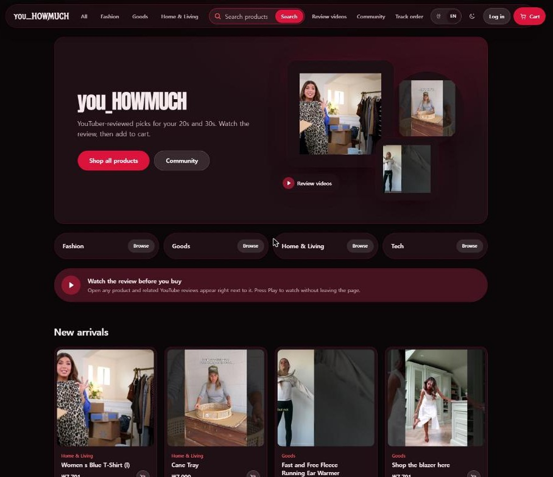 | 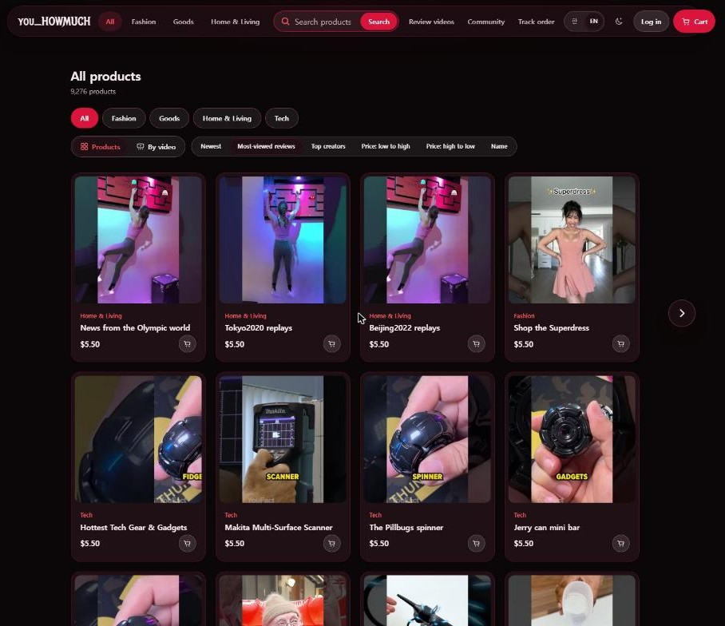 |

| 영문 상품 상세 | 영문 빠른 보기 |
|---|---|
| 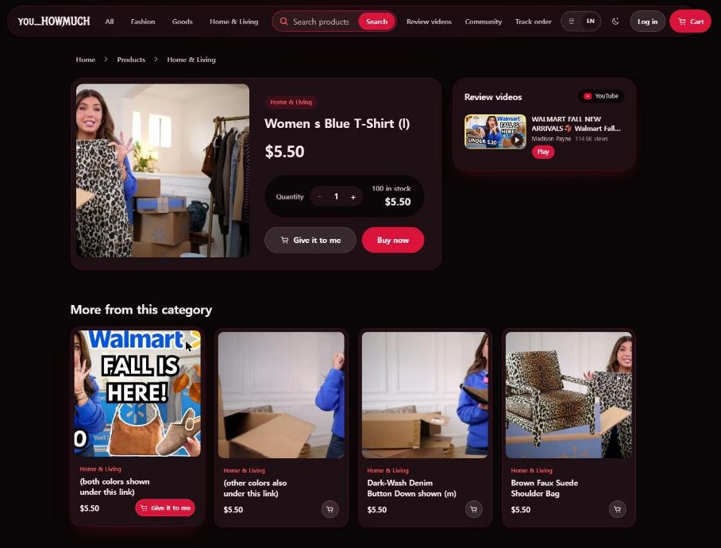 | 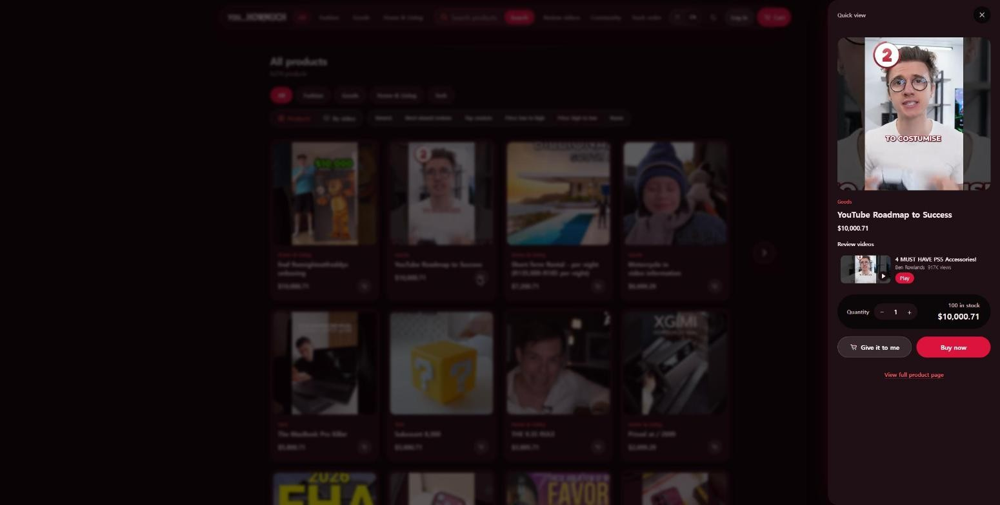 |

---

## 영문 페이지 설계 의도

영문 페이지는 한국어 화면의 **번역본이 아니라, 영미권 사용자를 위한 별도 매장**으로 설계했습니다.

| 설계 | 내용 | 이유 |
|---|---|---|
| 번역이 아니라 시장 전환 | 영어로 바꾸면 영미권 유튜버 영상(`regionCode=US`)에서 수집한 상품만, 영문 상품명으로 노출 (한국 4,433개 / 영미권 9,276개, 겹침 없음) | 글자만 영어로 바꾸면 한국 유튜버·한국 상품이 그대로 보여 영미권 사용자에게 의미가 없음 |
| 접속 시 자동 판별 | 직접 고른 언어(쿠키) → 브라우저 언어 → 접속 국가 → 한국어 | 처음 온 사람은 자기 시장으로, 한 번 고르면 고른 값을 존중 |
| 가격은 달러 | 저장·주문·재고 계산은 원화 하나로 유지, 영어 화면 표시만 달러로 환산 (1달러 = 1,400원, 수집 규칙과 같은 값) | 영미권 사용자는 원화 감각이 없음. 계산 로직을 둘로 나누지 않아 주문·결제 버그 위험이 줄고, 수집할 때 쓴 비율로 되돌려 원래 달러 가격과 거의 같음 |
| 브랜드명 분리 | 한국어 "하우머치" / 영어 "you_HOWMUCH" | 한국어는 소리 나는 대로 친근하게, 영어는 "How much?"가 그대로 읽히는 원래 이름 |
| 글꼴 | 개성 있는 제목 글꼴은 영어 화면의 로고·큰 제목에만. 한국어 화면과 상품명·설명은 기본 고딕 | 한글 장식 글꼴은 가독성이 떨어지고, 상품 정보는 언어와 상관없이 읽기 쉬워야 함 |
| 문구 톤 | 영어 "Give it to me" / 한국어 "장바구니에 담기" | 영어는 20·30 캐주얼 톤, 한국어는 익숙한 쇼핑 용어가 더 빨리 읽힘 |
| 문구 한 곳 관리 | 화면 문구는 `lib/i18n/dictionaries.ts` 하나, 영어 사전은 한국어와 같은 키를 갖도록 타입으로 강제 | 한쪽만 고치고 빠뜨리는 문구를 빌드 단계에서 막음 |

> 알려진 한계: 원화 저장 때 1,000원 단위로 올리는 규칙 때문에 달러 끝자리가 어색할 수 있음(예: $10,000.71). 수집 원본 달러 가격을 저장해 그대로 보여 주도록 개선 예정.

---

## 핵심 기능

자세한 내용과 진행 상태는 **[docs/FEATURES.md](docs/FEATURES.md)** 한 곳에서 관리합니다. 기능이 바뀌면 그 파일만 고치면 됩니다.

| 기능 | 한 줄 설명 |
|---|---|
| 영상 ↔ 상품 연결 | 상품 상세 옆 리뷰 영상 패널, [실행하기]를 누를 때만 유튜브 플레이어 로드 |
| 보는 방식 선택 | 상품별 / 영상별 묶음 보기 전환 |
| 빠른 보기 | 카드의 장바구니 아이콘 → 옵션 선택 시트, 카드를 누르면 상세 페이지 |
| 언어 = 시장 | 한국어 → 한국 상품·유튜버·원 / 영어 → 영미권 상품·유튜버·달러 (접속 언어·지역 자동 판별) |
| 자동 수집 | 유튜브 영상 설명란에서 제품을 찾아 등록 (영상 2,488개 → 상품 13,709개) |
| 빠른 목록 | 40개씩 서버에서 잘라 받기 (한 페이지 10.7MB → 116KB), 좌우 버튼·키보드 ← → 이동 |
| 회원 | 이메일 가입·로그인, 중복 없는 자동 닉네임(가입 화면에서 확인·변경), 로그인 유지 14일 |
| 테마 | 다크 고딕(블랙 + 크림슨) 기본, 화이트 초콜릿(+ 브라운) 라이트 |

---

## 사용법 (사이트 이용)

1. **둘러보기** — 상단 메뉴에서 카테고리(패션·잡화·리빙·디지털)를 고르거나 검색창에 상품명·유튜버 이름을 입력합니다.
2. **보는 방식 바꾸기** — 목록 위 `상품별 / 영상별` 버튼으로 전환합니다. 영상별 보기에서는 한 영상에 나온 상품이 묶여 나옵니다.
3. **정렬** — 최신순 · 리뷰 조회수순 · 유튜버 인기순 · 낮은/높은 가격순 · 이름순.
4. **페이지 넘기기** — 목록 옆 `‹ ›` 버튼, 아래쪽 페이지 번호, 또는 키보드 `←` `→`.
5. **빠르게 담기** — 카드 가격 옆 장바구니 아이콘을 누르면 빠른 보기 시트가 열립니다. 옵션·수량을 고르고 `장바구니에 담기`. 카드 자체를 누르면 상품 페이지로 갑니다.
6. **리뷰 영상 보기** — 상품 페이지 오른쪽 패널에서 `실행하기`를 누르면 그 자리에서 영상이 재생됩니다.
7. **주문** — 장바구니 → 주문서 작성 → 모의 결제. 비회원도 주문할 수 있고, `주문조회`에서 주문번호 + 연락처로 확인합니다.
8. **회원가입** — 이메일·비밀번호만 입력하면 추천 닉네임이 자동으로 들어갑니다. 🔄로 다시 뽑거나 직접 바꿀 수 있고, 가입 후 `내 계정`에서도 바꿀 수 있습니다.
9. **언어·테마** — 상단 `한 / EN`으로 언어(=상품 시장, 영어는 달러 표시), 🌙 버튼으로 다크/라이트를 바꿉니다. 선택은 브라우저에 저장됩니다.

---

## 실행 방법 (개발 환경)

```
I_sell_a_store/
├── backend/    Spring Boot 3.5.6 · Java 21 · JPA + JdbcTemplate · MySQL 8
├── frontend/   Next.js 15 (App Router) · CSS Modules + 디자인 토큰 · Zustand
└── docs/       FEATURES.md (기능 목록) · images/ (README 스크린샷)
```

### 준비물
- JDK 21, Maven (또는 IntelliJ / STS)
- Node.js 20 이상
- MySQL 8.0 (DB 이름 `my_db`)
- YouTube Data API v3 키 (없어도 실행은 됨, 영상 검색·수집만 안 됨)

### 1) DB 준비
- 테이블 기준은 `backend/db/schema.sql` — Workbench에서 한 번 실행합니다.
- 이미 만든 DB에 기능만 추가할 때(각 1회): `auth.sql`(회원) · `sourcing.sql`(수집) · `market.sql`(시장) · `frame-images.sql`(상품별 다른 영상 장면)
- DB 계정은 `backend/config/application.yml` (로컬 전용 root/root — 공개 서버에서는 반드시 바꿀 것)

### 2) 백엔드 — http://localhost:8080
```powershell
cd backend
$env:YOUTUBE_API_KEY="발급받은_키"    # 키는 깃에 올리지 않음
mvn spring-boot:run
```
- 연결 확인: http://localhost:8080/api/health/db
- 설정(`application.yml`)을 바꾸면 **백엔드를 다시 시작**해야 반영됩니다.

### 3) 프론트엔드 — http://localhost:3000
```powershell
cd frontend
copy .env.example .env.local
npm install
npm run dev
```

### 4) 데모 상품 수집 (선택)
```powershell
curl.exe -X POST "http://localhost:8080/api/admin/sourcing/start"     # 한국·영미권 번갈아 수집
curl.exe "http://localhost:8080/api/admin/sourcing/status"            # 진행 상황
curl.exe -X POST "http://localhost:8080/api/admin/sourcing/stop"      # 중단 (등록 상품 유지)
```
> 유튜브 검색 1페이지 = 100 units, 하루 기본 10,000 units. 매일 17시(KST) 초기화.

### 관리자 화면 — http://localhost:3000/admin
`frontend/.env.local`에 `NEXT_PUBLIC_ENABLE_ADMIN=true`일 때만 열립니다. 상품·옵션·재고 편집, 상품별 영상 고정·제외.
> ⚠️ 관리자 API에는 아직 인증이 없습니다. 공개 배포 전 반드시 막아야 합니다.

---

## 코드 구조

**백엔드** (`com.isellastore`) — 기능별 폴더 안을 계층으로 나눔
```
global/   설정 · 공통 예외 · DB 상태       member/   회원 (세션 로그인 · 닉네임 · CSRF · 실패 제한)
site/     브랜드·기능 구성               catalog/  상품·영상 목록 SQL · 페이지 나눔 · 썸네일 장면 배정
product/  상품 상세·관련 상품            order/    주문 · 모의 결제
youtube/  영상 캐시 · 유튜브 API         sourcing/ 영상 설명란 제품 수집
```

**프론트엔드** — M·V·C + 스타일 분리
```
app/          라우트(페이지) — views를 조립만 함
models/       데이터 모양 · 백엔드 호출 (api/)
controllers/  use*.ts 훅 (장바구니 · 빠른 보기 · 페이지 이동 · 회원 폼 …)
views/        화면 컴포넌트 + 같은 이름의 *.module.css
lib/          순수 계산 · i18n(언어 판별·사전) · 테마
styles/       tokens.css (색·간격·글꼴 — 디자인은 여기만 수정) · globals.css
docs/         auth-api.md · market-api.md · community-api.md (API 규격)
```

---

## 설정으로 바꾸는 곳

| 항목 | 바꾸는 곳 |
|---|---|
| 사이트 이름·문구·연락처 | 환경변수 `BRAND_*` (`backend/.env.example`) — 한국어 이름 "하우머치"는 `frontend/models/api/siteApi.ts` |
| 색·글꼴·간격 (다크/라이트) | `frontend/styles/tokens.css` |
| 화면 문구·영어 번역 | `frontend/lib/i18n/dictionaries.ts` |
| 달러 환산 비율 | `NEXT_PUBLIC_USD_KRW_RATE` (`frontend/.env.example`, 백엔드 `sourcing.usd-krw-rate`와 같게) |
| 기능 켜고 끄기 | `FEATURE_CART`, `FEATURE_PAYMENT`, `FEATURE_YOUTUBE_PANEL` |
| 유튜브 키 | 환경변수 `YOUTUBE_API_KEY` |
| 실제 결제 | `PaymentGateway` 구현체 추가 (포트원/토스) |

---

## 참고
- 영상은 YouTube 공식 임베드 플레이어로만 재생합니다. [YouTube API 개발자 정책](https://developers.google.com/youtube/terms/developer-policies)에 따라 광고를 막거나 플레이어를 바꾸지 않습니다.
- 상품 이미지는 리뷰 영상의 장면을 사용합니다. 공개 서비스로 전환할 때는 이미지 출처 정책을 따로 정해야 합니다.

## 연락처
대표 김다운 · [naluteo89@gmail.com](mailto:naluteo89@gmail.com)
